# MARCO Crystallisation Image Triage — Report

*Individual MSc Data Science AI coursework. Code: this repository. Experiment log:
`experiments/log.csv`. AI-use declaration: `docs/ai_use_log.md`.*

**Report structure:** this report follows the project's actual workflow rather than a strict
Q1→Q6 reading order. Every section is tagged with the brief question(s) it covers, and all six
(Q1–Q6) are present: Dataset Description and EDA (Q1) → Classical Baseline (Q3) → ANN: Initial
and Final Models (Q2, Q3) → Model Comparison (Q3) → Explainable AI (Q5) → GenAI Evaluation (Q6)
→ Full Model Comparison incl. GenAI (Q3, Q6) → Unsuccessful Experiments (Q3, Q6) → Error
Predictions and Analysis (Q3, Q5) → Web Application (Q4).

---

# Dataset Description and EDA (Q1) {.pagebreak}

*Source: `notebooks/01_eda.ipynb`, `scripts/download_extract.py`, `scripts/make_splits.py`.
Figures in `docs/figures/`.*

## Dataset description and licence

The dataset is MARCO (MAchine Recognition of Crystallization Outcomes), published by the
University at Buffalo Center for Computational Research (https://marco.ccr.buffalo.edu) under a
Creative Commons Attribution 4.0 International licence (CC BY 4.0). MARCO combines protein
crystallisation drop images from five contributing institutions, each expert-scored into one of
four classes: `Clear`, `Crystals`, `Precipitate`, `Other`. `Crystals` is the decision-relevant
class — it is the trigger for harvesting a drop and sending it for beamline data collection.

The full published dataset is distributed as TFRecord shards (~55GB, ~463,000 images; see
`scripts/download_extract.py` for the download/extract pipeline). For this coursework, 15 shards
were pulled (evenly spaced across the full shard range to avoid any shard-level sampling bias),
giving **14,367 images**. This wasn't an arbitrary choice of 15: an exploratory chi-square check
on 3 individual shards (1, 100, 300; `notebooks/00_download_explore.ipynb`) found one shard
(300) statistically inconsistent with the full population on its own (χ²=10.34, p=0.016, driven
by Crystals being overrepresented there), confirming single shards are too noisy to trust
individually — pooling all 3 resolved this (χ²=4.53, p=0.210, not significant), which is the
direct motivation for pulling multiple shards for the working dataset rather than just one or
two. A fixed, one-time train/val/test split was then built (`scripts/make_splits.py`) and is
never regenerated — see the Leakage checks section below.

## Class and source distributions

All statistics in this section use **train + val only** (12,314 images); the test split
(2,053 images) is read only by `scripts/final_eval.py`, per the project's test-isolation rule.

<div style="page-break-inside: avoid;">

**Class distribution:**

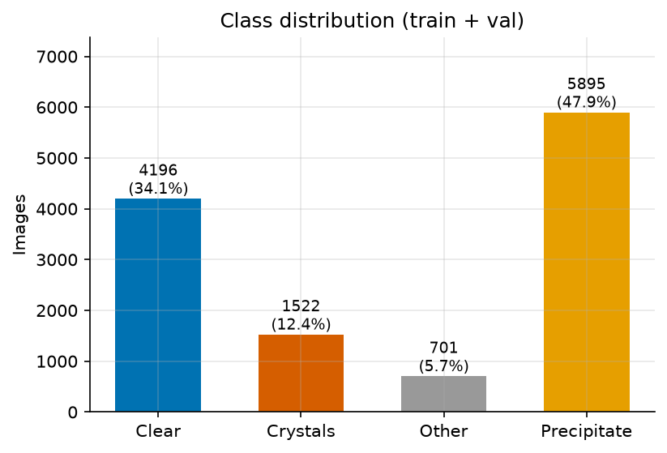

</div>

| Class | Count | % |
|---|---|---|
| Precipitate | 5,893 | 47.9% |
| Clear | 4,195 | 34.1% |
| Crystals | 1,522 | 12.4% |
| Other | 704 | 5.7% |

Crystals is a genuine minority class at ~12% — close to the published MARCO train-split figure
of 12.8% across all 407 shards (415,775 images; `notebooks/00_download_explore.ipynb`). This was
tested formally, not just eyeballed: a chi-square goodness-of-fit test of this sample's 4-class
counts against the full population's proportions gives χ²=2.53, df=3, p=0.470 —
nowhere near significant, so the sample's label distribution is statistically consistent with
the full dataset (`notebooks/01_eda.ipynb`).

**Source institution distribution:** five source institutions contribute images, very
unevenly — source 3 alone accounts for 7,632 of 12,314 images (62%); sources 0 and 4
contribute only 371 and 225 images respectively.

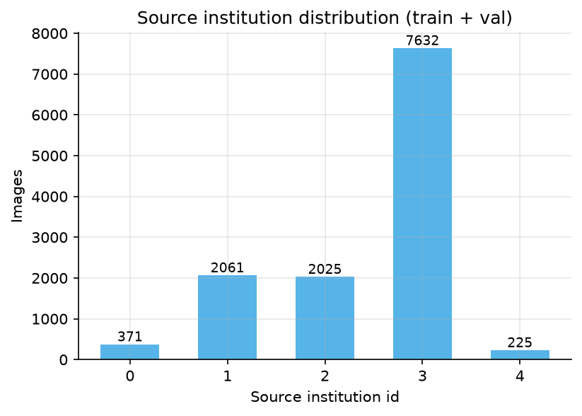

<div style="page-break-inside: avoid;">

**Class composition by source:**

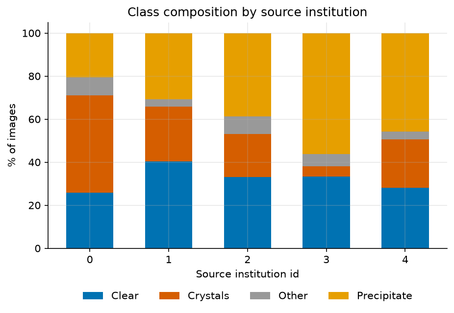

</div>

| Source | Clear | Crystals | Other | Precipitate |
|---|---|---|---|---|
| 0 | 25.9% | **45.3%** | 8.4% | 20.5% |
| 1 | 40.3% | 25.5% | 3.5% | 30.7% |
| 2 | 33.1% | 20.0% | 8.0% | 38.8% |
| 3 | 33.2% | **4.9%** | 5.6% | 56.3% |
| 4 | 28.0% | 22.7% | 3.6% | 45.8% |

The Crystals rate swings nearly 9x across institutions (4.9% to 45.3%), and the single most
common institution (source 3, 62% of the data) has the *lowest* Crystals rate. See Finding 2
below — and the Error Predictions and Analysis section (Q3), where this prediction is borne out
on the test set.

**Image size and quality** (dimensions sampled, n=500, seed=42): image dimensions are not
standardised — sizes range from 632×504 to 2448×2048, with 1280×960 as the single most common
size (~70% of the sample) but far from universal. See Finding 3 below.

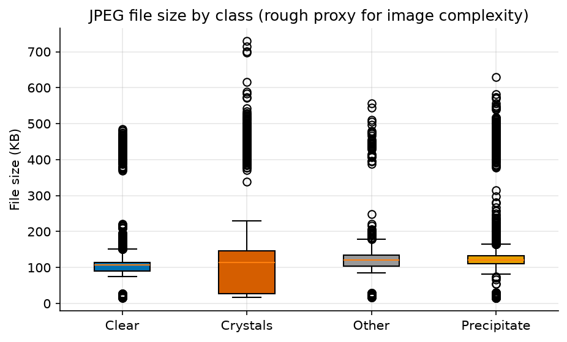

## Leakage checks

Images of the same physical drop (same plate/well, imaged on different days or under different
microscopy modes) must stay entirely on one side of the split — otherwise a model could
effectively see a near-copy of a test image during training. MARCO's metadata carries no
explicit plate/well ID, so grouping keys were recovered from filename conventions, which differ
by source institution:

1. **`plateID<N>...wellNum<N>`** filenames → grouped by (plate, well) directly. 7,632 images
   (source 3).
2. **`<hash>_<well>_...`** filenames (e.g. `06d7_E4_CrossPolarization_9.jpg`) → grouped by
   (hash, well). 1,818 images (source 1).
3. **`X` + 9-digit plate + 4-digit well + 12-digit timestamp** filenames → grouped by (plate,
   well). 2,025 images (sources 0/2/4). This pattern was not obvious and was verified before use:
   the decoded well numbers fall in 1–1536 (a real high-density microplate format), and the
   decoded timestamps are all valid dates in 2004–2005, matching MARCO's known imaging period.
4. Remaining images with no filename grouping information (439 images): grouped by an 8×8
   average-image-hash, **restricted to same-label matches only** — a hash collision across
   *different* ground-truth labels is a false positive (confirmed empirically: one 51-image
   single-hash group turned out to be visually similar but physically different `Clear` wells,
   not one drop). Grouping unrelated images together this way is safe for the split (it never
   lets a true duplicate land on both sides), just conservative.

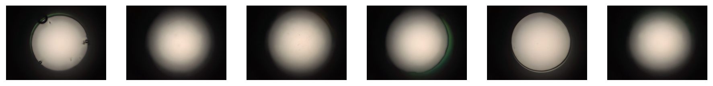

**A real leak was found and fixed.** The first version of this pipeline did not recognise
pattern 3 above, so those 2,025 images fell back to the hash method. Two near-identical
`Crystals` images of the same well (`X000005130_w1048`, imaged 3 weeks apart — same distinctive
star-burst crystal cluster) produced different hashes (lighting changed between sessions) and
so were never grouped — one landed in `test`, the other in `val`.

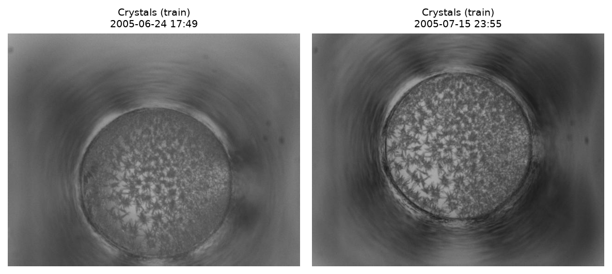 Once pattern 3 was added, the split was regenerated a single time, before any model had
used it (the project's "one fixed split" rule only permits a fixed split; this was treated as a
one-time methodology correction at the EDA stage, not a re-split for better numbers — see
`docs/split_v2_note.md`). Regenerating moved far more than the two affected images: 6,328 of
14,367 images (44%) ended up in a different split, because the splitter's internal shuffling
is sensitive to the exact set of group labels, not just the grouping structure — reinforcing why
the split is now permanently fixed.

**Comprehensive verification.** After the fix, every group across all four tiers was checked
against all three splits (not just train/val): **0 of 13,578 groups span more than one split.**
This is enforced both at build time (`scripts/make_splits.py` asserts it) and independently
re-verified in the EDA notebook.

**Label drift within groups.** Of 393 multi-image groups (train+val), 61 (15.5%) contain more
than one label. A deeper check cross-referencing the `_d<N>_` imaging-round marker in filenames
found 58 of these 61 drift groups are plate+well-pattern groups carrying day-number information,
and 47 of those 58 (81%) span more than one drop number — meaning most label drift is
**different drops sharing a well**, not one drop's state changing over time. The initial
"kinetic process" explanation was only partially right and was revised after checking. Either
way, the split still keeps the whole group together regardless of label; each group's majority
label is used only to decide which split it goes to, not as a claim the group has one true label.

**Limitation: relationships beyond the well.** All grouping above protects against the same
physical drop (same plate+well) appearing in more than one split. It does not, and cannot,
protect against the same protein or the same screening conditions being run on a *different*
plate — common practice in crystallisation screening (replicate plates, repeat attempts, broader
condition screens). Two images from different plates could still share protein-specific visual
characteristics without being the same physical drop. MARCO's metadata carries no protein ID,
batch ID, or experiment ID linking plates together, and nothing in the filenames identifies this
either, so this risk cannot be detected or controlled for with the metadata available. This is a
residual limitation of the dataset itself, not a gap in the grouping method described above.

## FP/FN consequences and metric justification

A false negative — a `Crystals` drop the model misses — can mean losing a hit produced from
scarce, expensive protein; the opportunity may not be recoverable. A false positive costs a
crystallographer a few minutes of unnecessary manual inspection. These costs are highly
asymmetric, and Crystals is a minority class (~12%), so **overall accuracy is unsuitable** as a
headline metric. Concretely: always predicting the majority class (`Precipitate`) scores 47.9%
accuracy while achieving 0% Crystals recall — every crystal hit would be missed despite a
seemingly reasonable accuracy figure.

**Primary metric:** recall on `Crystals` at a fixed minimum precision, **`P_MIN = 0.30`**, with
PR-AUC for Crystals as a supporting metric. Set from the classical baseline's validation PR
curve (base rate ~12.4%; `P_MIN = 0.30` gives ~85% recall while precision stays ~2.4x the base
rate — see `docs/primary_metric.md` for the full reasoning). This value is fixed for every model
family (classical baseline, every ANN variant, GenAI evaluation).

## Three findings that constrain modelling

1. **Crystals is a real minority class (~12% of train+val)**, and the cost of missing one is far
   higher than a false alarm. This rules out accuracy as the headline metric and means the loss
   function/sampling strategy needs to account for the imbalance directly (e.g. class weighting),
   not rely on the model discovering it unaided.
2. **Class mix varies sharply by source institution.** Source 3 (62% of all data) has only 4.9%
   Crystals, while source 0 has 45.3% Crystals — a 9x swing. Since one institution dominates the
   pool, a model could end up implicitly tuned to that institution's imaging style and
   under-perform on the others. This bears directly on the web app's stated limitation about
   unseen imagers (Q4) and is confirmed on the test set in the Error Predictions and Analysis
   section.
3. **Image dimensions are not standardised.** A 500-image sample spans 632×504 up to 2448×2048,
   with 1280×960 as the dominant but not universal size (~70%). This constrains preprocessing —
   an explicit, documented resize/aspect-ratio strategy is needed rather than an assumption that
   every image already arrives at a fixed input size.

---

# Classical Baseline (Q3) {.pagebreak}

*Source: `src/marco/features.py`, `scripts/train_baseline.py`, `experiments/log.csv`.*

LightGBM (gradient-boosted trees) on hand-crafted **HOG + LBP** features
(`src/marco/features.py`), chosen over XGBoost and SVM after comparing the three on
implementation complexity, training speed, and native multiclass + feature-importance support
— LightGBM's histogram-based splitting trains fast enough on ~10K images to afford a search
budget of the same order as the ANN (CLAUDE.md's fair-comparison rule), without SVM's poor
scaling to thousands of samples or XGBoost's slower default training on this data size. HOG
(histogram of oriented gradients) targets edge/gradient structure — crystal facets and needle
shapes have sharp, consistent edges that HOG is designed to capture; LBP (local binary
patterns) targets local texture — precipitate's grainy, granular appearance versus Clear's
smooth uniformity is a texture distinction, not an edge one. Together they give the model two
complementary, interpretable signal types without needing a learned feature extractor, which
is the point of a classical baseline: a meaningfully different approach from the ANN, not a
weaker version of it. `class_weight='balanced'` handles the same Crystals minority-class
problem (Q1 Finding 1) that motivates the ANN's class-weighted loss.

One concrete illustration of this interpretability difference: a single tree from the trained
ensemble (first boosting round, `Crystals` class — LightGBM's multiclass objective trains one
tree per class per round) can be read directly as a sequence of threshold rules, something no
equivalent single component of the ANN can offer.

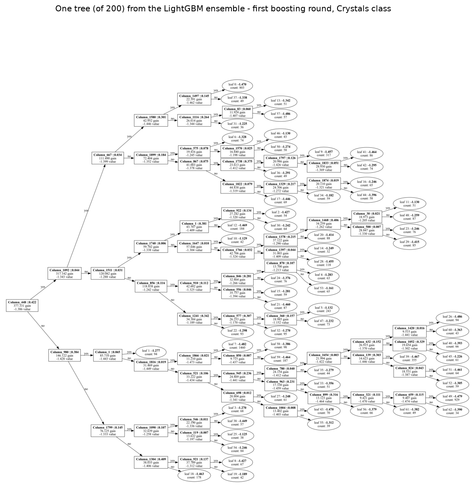

*Read honestly: this is one of 800 trees in the ensemble (200 boosting rounds × 4 classes —
`clf.booster_.num_trees()` confirms this directly), not the model's full decision logic —
boosted trees only make sense in aggregate. The splits are also on anonymous `Column_N`
indices into the 1924-dim HOG+LBP feature vector, not human-readable feature names, so the
tree's actual thresholds aren't independently meaningful without mapping back to specific
HOG/LBP bins. What it does show concretely is that gradient-boosted trees are inherently
inspectable at this level — in clear contrast to the ANN, which needed Grad-CAM/occlusion/LIME
(Q5) just to get an approximate, non-provable sense of what influenced one prediction.*

Unlike a single tree, **aggregate feature importance** (total split gain, summed across all
800 trees — all 4 classes, not just Crystals) is representative of the whole ensemble, not one
boosting round's idiosyncrasies:

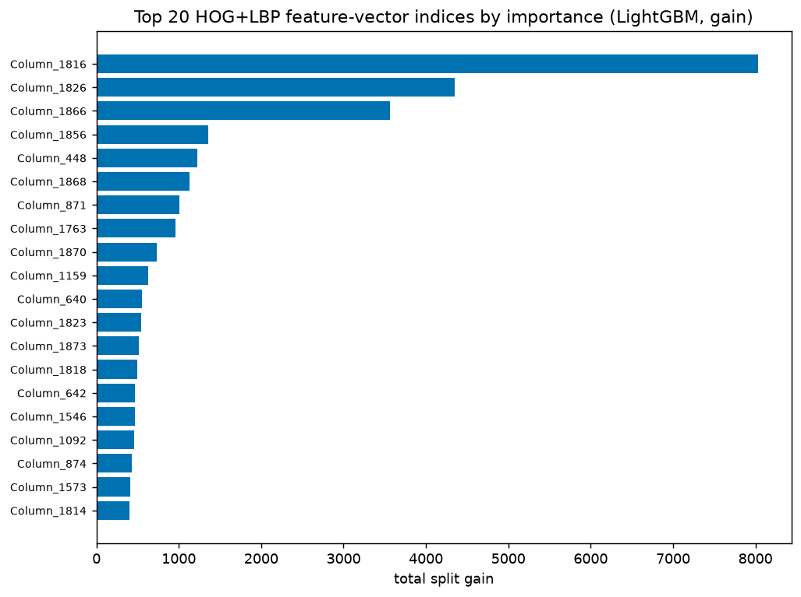

The top 20 split exactly evenly between HOG (edge/gradient) and LBP (texture) features — 10
each — and the single most important feature is an LBP (texture) one. This is consistent with
the feature design rationale above: both signal types contribute meaningfully, neither
dominates outright, supporting the choice to use both rather than either alone. (This claim is
tested directly, not just inferred from the chart, via a feature-ablation experiment — see
Unsuccessful Experiments below.)

---

# ANN: Initial and Final Models (Q2, Q3) {.pagebreak}

*Source: `src/marco/model.py`, `src/marco/data.py`, `docs/expectation.md`,
`scripts/train_ann.py`, `experiments/log.csv`, `notebooks/03_ann_initial.ipynb`,
`notebooks/06_ann_final.ipynb`, `docs/ann_initial_training.md`.*

## Architecture

A pretrained ResNet backbone (ResNet18 or ResNet34, ImageNet weights) with a new, deliberately
simple classifier head: `Dropout(0.4)` → `Linear(in_features, 4)`. Two fine-tuning degrees are
used across the project: **frozen** (only the head trains — the Initial ANN) and **layer4**
(the backbone's last residual block also trains — the Final ANN).

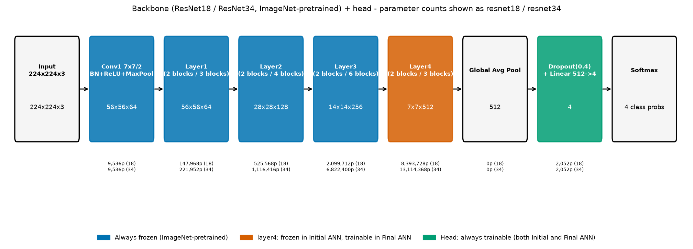

*Figure: layer-by-layer shape and parameter counts (`scripts/make_architecture_diagram.py`,
read directly from the constructed model, not hand-copied). Blue = always frozen
(ImageNet-pretrained); orange = `layer4`, frozen in the Initial ANN and trainable in the Final
ANN; green = the head, always trainable.*

| | ResNet18 | ResNet34 |
|---|---|---|
| Total parameters | 11,178,564 | 21,286,724 |
| Trainable, frozen | 2,052 (head only) | 2,052 (head only) |
| Trainable, layer4 unfrozen | 8,395,780 | 13,116,420 |

Input: 224×224×3, direct resize (no centre crop — crystals can sit at the drop edge, so cropping
risks cutting out the decision-relevant signal), ImageNet mean/std normalisation.

## Justification of individual choices

- **Depth (ResNet18 vs ResNet34):** treated as the network-depth hyperparameter (one of the
  three required hyperparameters) rather than fixed in advance — compared empirically in the
  search below, not assumed.
- **Width:** inherited from the pretrained backbone, not redesigned — modifying channel widths
  would discard the pretrained weights' structure for no clear benefit on a ~10K-image dataset.
- **Normalisation:** the backbone's existing BatchNorm layers are kept, but frozen (eval mode)
  when their parent conv layers are frozen too — `src/marco/model.py`'s `freeze_backbone_bn()`
  exists specifically because `model.train()` otherwise resets *every* submodule to train mode
  each epoch, including frozen ones, silently letting BatchNorm's running statistics drift even
  though the conv weights themselves are fixed.
- **Regularisation:** `Dropout(0.4)` in the head only. The learning curves below show no
  overfitting at all (val loss never diverges upward from train loss), so a heavier
  regularisation scheme was not pursued — dropout was kept fixed rather than swept as a 4th
  hyperparameter for exactly this reason (see `docs/ann_initial_training.md`).
- **Output layer / loss:** 4-way softmax via `CrossEntropyLoss`, **class-weighted** by
  inverse training-set frequency (`compute_class_weights()` in `src/marco/data.py`) — the same
  class-imbalance principle as the classical baseline's `class_weight='balanced'`, needed
  because of Q1's Finding 1 (Crystals is a genuine ~12% minority).
- **Head complexity:** a single Dropout+Linear layer, not a multi-layer MLP — the pretrained
  features are already strong, and a deeper head adds overfitting risk on a modest dataset for
  no established benefit.
- **Augmentation:** horizontal/vertical flip, 90°-multiple rotation (not continuous — a
  right-angle rotation needs no interpolation/padding), colour jitter, random greyscale, mild
  Gaussian blur — justified directly from the EDA (drop orientation carries no signal; source
  institutions differ in colour/quality, EDA Finding 2–3).

## Alternatives considered and rejected

- **Training from scratch:** rejected — ~10K images is too little to learn good low-level
  features from nothing; transfer learning from ImageNet is the standard, better-justified
  choice for a dataset this size.
- **A deeper/wider custom CNN:** rejected for the same reason as a complex head — no established
  benefit on this data scale, and harder to justify/explain at the viva than a well-known,
  explainable backbone.
- **Full fine-tuning (unfreezing the whole backbone) as the 4th hyperparameter:** considered but
  not pursued — higher overfitting risk on ~10K images, and the Initial ANN's learning curves
  already pointed specifically at `layer4` (not earlier layers) as the bottleneck, making a
  partial, targeted unfreeze the better-justified choice. Approved by the lecturer as the
  optional 4th hyperparameter — see `docs/lecturer_approval_fine_tuning.md`.
- **Dropout rate as a 5th swept hyperparameter:** rejected — the evidence (no observed
  overfitting) didn't support it, and CLAUDE.md only pre-names degree-of-fine-tuning as the
  sanctioned optional 4th. See `docs/ann_initial_training.md` for the full reasoning.

## Pre-registered expectation (Q2.b)

Written in full in `docs/expectation.md`, dated before `scripts/final_eval.py` ever touched the
test split, never edited afterwards. Summary: **the ANN was predicted to win on the primary
metric**, based on validation evidence (0.925 vs. 0.850 recall@P_MIN) and the expectation that
CNN features would capture Crystals-vs-Precipitate texture differences better than HOG+LBP — with
an explicit, honest caveat that validation PR-AUC actually favoured the baseline (0.652 vs.
0.572), so the prediction was not a foregone conclusion. See Model Comparison, below, for
whether this held on test.

## Hyperparameter search

Random search (seeded, `numpy.random.default_rng(42)`), 12 configs for the Initial ANN (frozen)
and 12 for the Final ANN (layer4), same grid for both so the only axis that differs between them
is the fine-tuning degree:

| Hyperparameter | Values | Required? |
|---|---|---|
| Learning rate | 0.0003, 0.001, 0.003, 0.01 | Required (1 of 3) |
| Batch size | 16, 32, 64 | Required (2 of 3) |
| Network depth | ResNet18, ResNet34 | Required (3 of 3) |
| Degree of fine-tuning | frozen, layer4 | Optional 4th, lecturer-approved |

Each of the 12 configs independently samples a backbone, learning rate, and batch size from
this 4×3×2=24-point grid (not 12 unique points drawn without replacement) — in practice this
gave 11 unique combinations with one repeat (`resnet34`, lr=0.001, batch=32, tested twice), the
same order of magnitude as the classical baseline's 24-config search (CLAUDE.md's
fair-comparison rule). Optimiser:
Adam for all ANN configs; the classical baseline's gradient boosting (LightGBM) is the second,
mechanically different optimiser required by the coursework, compared directly on the same task.

<div style="display:flex; flex-wrap:wrap; gap:4%; align-items:flex-start;">
<div style="width:48%;">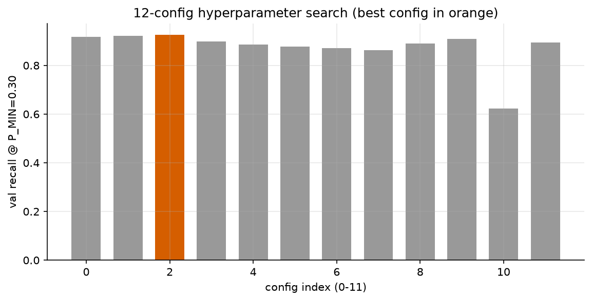<p style="text-align:center; font-size:0.85em; margin-top:0.2em;">Initial ANN (frozen) — 12-config search</p></div>
<div style="width:48%;">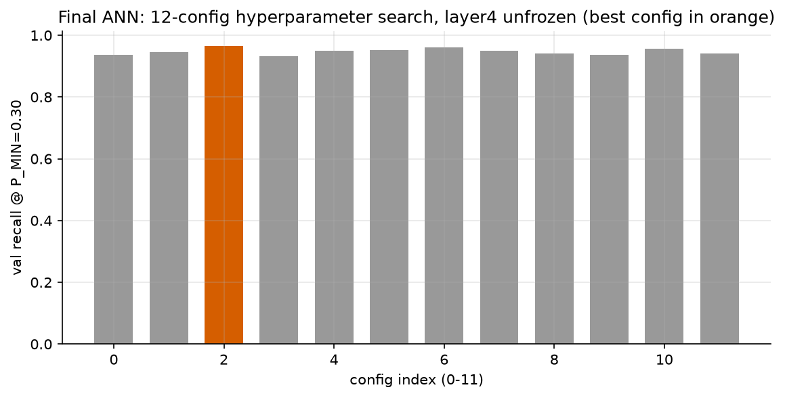<p style="text-align:center; font-size:0.85em; margin-top:0.2em;">Final ANN (layer4 unfrozen) — 12-config search</p></div>
</div>

One config in the Initial ANN's search diverged outright — see Unsuccessful Experiments, below,
for the full diagnosis. The Final ANN's search (right) has no such failure: every config trains
stably, and its best (`ann_final_008`, resnet34, lr=0.001, batch=32, recall@P_MIN=0.965)
clears every Initial ANN config by a wide margin — the visual gap between the two charts is the
clearest single piece of evidence that unfreezing `layer4` was the right call.

## Learning curves and under/overfitting diagnosis

<div style="display:flex; flex-wrap:wrap; gap:4%; align-items:flex-start;">
<div style="width:48%;">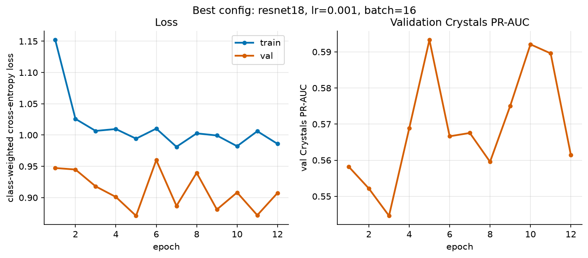<p style="text-align:center; font-size:0.85em; margin-top:0.2em;">Initial ANN (frozen) — best config</p></div>
<div style="width:48%;">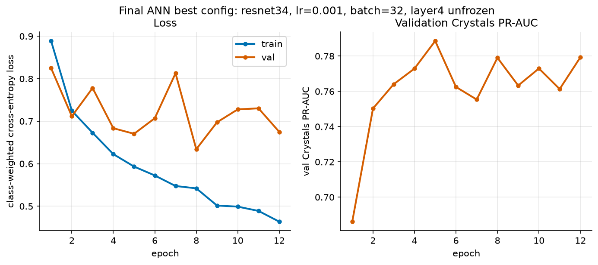<p style="text-align:center; font-size:0.85em; margin-top:0.2em;">Final ANN (layer4 unfrozen) — best config</p></div>
</div>

**Initial ANN (left):** both train and val loss drop in epoch 1, then plateau — train loss sits
around 0.99–1.01, val loss fluctuates 0.85–0.97 for the remaining 11 epochs, with neither curve
trending away from the other. This rules out classic overfitting (val loss would climb while
train loss kept falling) but also means the frozen head stops improving almost immediately: with
the backbone frozen, only a Dropout+Linear head is learning, which is not enough capacity to keep
extracting more signal from the fixed ImageNet features. (Val loss sitting *below* train loss for
most epochs is expected, not a bug — `Dropout(0.4)` is active during training and off during
evaluation.) This plateau was the direct motivation for the Final ANN (layer4 unfreeze).

**Final ANN (right):** unfreezing `layer4` visibly changes this picture — train loss keeps
falling across all 12 epochs (0.89 → 0.46), never plateauing the way the Initial ANN's did,
because there is now real additional capacity to keep learning from. Val loss is noisier and
does not track train loss as closely (fluctuating 0.63–0.81 with no clear trend either way), and
val Crystals PR-AUC climbs from 0.69 to the 0.75–0.79 range and then plateaus there rather than
climbing further. This is a mild train/val gap, consistent with the extra capacity being used,
but not runaway overfitting — val PR-AUC never collapses, and the test-set result (Model
Comparison, below) confirms the improvement generalised rather than just fitting validation
noise.

---

# Model Comparison (Q3)

*Source: `scripts/final_eval.py`, `experiments/log.csv`.*

## Comparison table (test set, all 2,053 test images)

| Model | recall@P_MIN (primary) | Crystals PR-AUC | Accuracy | Training time | Inference latency |
|---|---|---|---|---|---|
| Trivial benchmark (majority class) | 0.000 | 0.124 | 0.480 | ~0s | ~0 ms |
| Classical baseline (LightGBM, HOG+LBP) | 0.937 | 0.678 | 0.812 | 28.9s | 0.03 ms (CPU) |
| Initial ANN (frozen) | 0.886 | 0.672 | 0.715 | 1060s | 6.3 ms (GPU) |
| **Final ANN (layer4 unfrozen)** | **0.965** | **0.823** | 0.809 | 1058s | 6.2 ms (GPU) |

**The pre-registered expectation (ANN wins) is confirmed — by the Final ANN.** But the result
is more nuanced than a clean win: **the Initial ANN actually loses to the baseline on test**
(0.886 vs. 0.937), despite winning clearly on validation (0.925 vs. 0.850) — a genuine
validation/test reversal, reported honestly rather than smoothed over (CLAUDE.md rule 7). The
Final ANN's advantage, by contrast, held and even grew relative to validation (0.965 on both),
which is stronger evidence that unfreezing `layer4` produced a real improvement rather than
overfitting to the validation set through repeated model selection.

One-time GPU training cost: Initial ANN ≈ $1.21, Final ANN ≈ $1.22 (RunPod RTX 4090, from
logged `train_time_s`) — see `docs/genai_evaluation.md` for the full cost discussion including
unproductive spend on unreliable rented GPU pods during this project (≈$3-5 more).

**Supporting validation-phase figures** (model selection used only these, never test):

<div style="display:flex; flex-wrap:wrap; gap:4%; align-items:flex-start;">
<div style="width:48%;">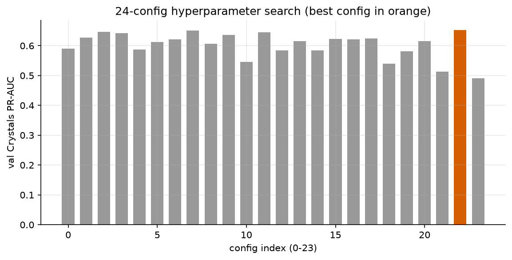<p style="text-align:center; font-size:0.85em; margin-top:0.2em;">Baseline hyperparameter search</p></div>
<div style="width:48%;">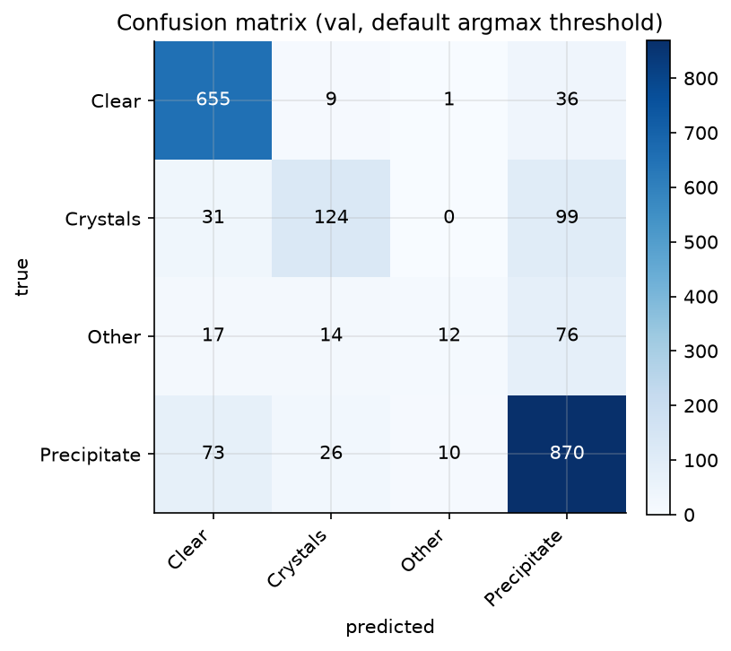<p style="text-align:center; font-size:0.85em; margin-top:0.2em;">Baseline confusion matrix</p></div>
<div style="width:48%;">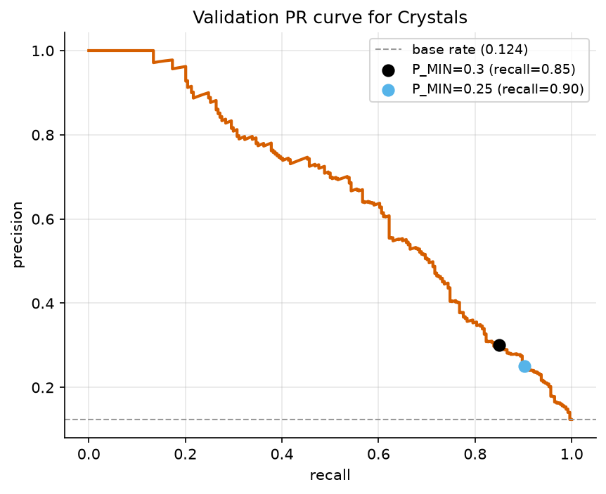<p style="text-align:center; font-size:0.85em; margin-top:0.2em;">Baseline PR curve</p></div>
<div style="width:48%;">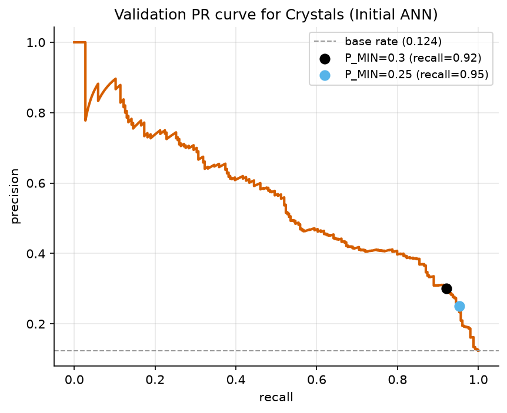<p style="text-align:center; font-size:0.85em; margin-top:0.2em;">Initial ANN PR curve</p></div>
</div>

The baseline's own validation confusion matrix above shows the same Precipitate-heavy
confusion pattern that reappears in the Final ANN's test confusion matrix in Error Predictions
and Analysis, below — Precipitate is the largest source of error for both model families, not
something specific to one architecture (consistent with Q1's observation that Precipitate
overlaps visually with both Crystals and Other at the texture level).

---

# Explainable AI (Q5) {.pagebreak}

*Source: `src/marco/xai.py`, `app/backend/main.py`, `notebooks/04_xai.ipynb`,
`docs/references.md`.*

Three methods: **Grad-CAM** (architecture-specific, targets `layer4` — the block actually
fine-tuned, Selvaraju et al. 2017), live in the web app as the primary method; **Occlusion**
(model-agnostic, sliding-window sensitivity) and **LIME** (model-agnostic, superpixel-based,
Ribeiro et al. 2016), both compared against Grad-CAM in `notebooks/04_xai.ipynb`. All three are
applied to three misclassified test images — see Error Predictions and Analysis, below, for the
cases themselves and what each method found.

### Two required sanity checks

1. **Occlude the Grad-CAM region, check the prediction changes:** covering the highlighted
   region on the false-alarm case (see Error Predictions and Analysis, below) dropped the
   predicted Crystals probability from 0.624 to 0.136.

   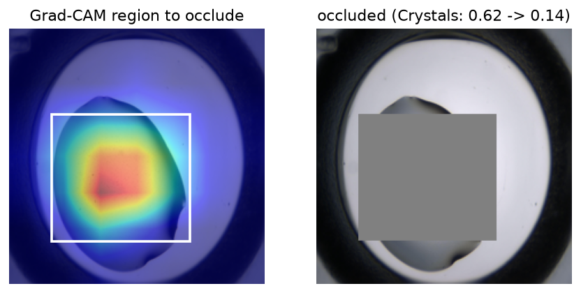

2. **Model randomisation** (Adebayo et al., 2018): re-initialising the trained layers
   (`layer4`+head) with random weights changed the Grad-CAM heatmap substantially — correlation
   -0.33 with the trained model's heatmap, confirming the explanation genuinely depends on what
   the model learned, not just its architecture.

   <div style="page-break-inside: avoid;">

   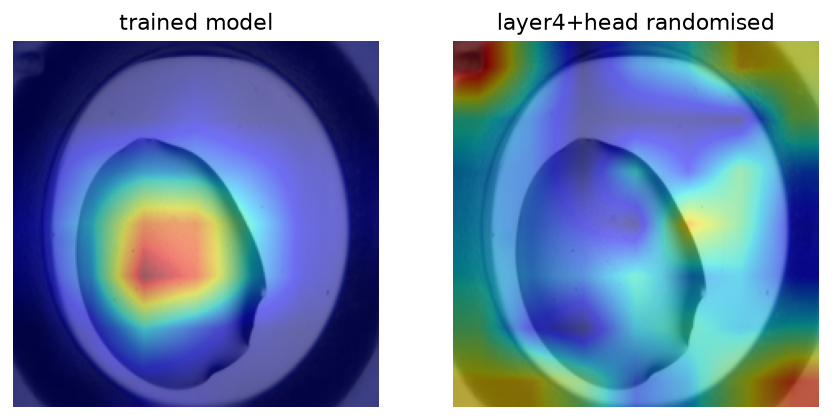

   </div>

**Limitations, stated explicitly throughout** (notebook and app): none of these methods prove
the model's true internal reasoning. Agreement across methods is reassuring where it happens,
but a confounded feature correlating with the right region would produce the same agreement.
Grad-CAM is presented to the crystallographer as "where to look," not a verdict.

---

# GenAI Evaluation (Q6) {.pagebreak}

*Full detail in `docs/genai_evaluation.md`. Summary here.*

**Model:** `claude-haiku-4-5-20251001` (Anthropic Claude Haiku 4.5), via the Anthropic Messages
API, zero-shot (no MARCO training), 512px-resized images, JSON-only structured output
(`predicted_class` + `crystals_likelihood` 0-100, the latter used as the continuous score for
the primary metric). **Prompt selected on validation only, never test**, in two stages:

An initial 12-image comparison picked **v1** over v2 (6/12 vs. 4/12; v2's extra visual-cue
guidance made the model over-call "Crystals"). That result was locked in and used for the
official test-set evaluation below. Afterwards, with time still available before the deadline,
the comparison was redone properly powered — all four prompt variants tried so far, on the same
stratified 249-image **validation** sample (`scripts/eval_genai.py --split val`, never test):

| Prompt | What it changes | Accuracy | Crystals PR-AUC | recall@P_MIN |
|---|---|---|---|---|
| v1 (the one used for the official test result) | baseline descriptive prompt | 0.273 | 0.149 | 0.000 |
| v2 | extra visual cues per class | 0.269 | 0.113 | 0.000 |
| v3 | minimal — just the four class names | 0.394 | 0.140 | 0.032 |
| v4 | conservative — requires 2+ clear facets for "Crystals" | **0.386** | **0.235** | **0.194** |

v2 underperforms v1 and is one of the required unsuccessful experiments (see Unsuccessful
Experiments, below, for the full diagnosis — including the genuinely surprising result that v3
and v4 beat v1, and what that implies about this prompt comparison's methodology).

The official test-set result further below still uses v1, exactly as locked in before test was
touched — per the test-isolation rule, the v3/v4 finding does not trigger a re-run on test with
v4, however tempting that would be.

**Evaluated on the full 2,053-image test set** (a smaller 250-image sample was run first to
measure real cost/time before committing to the full set — it was cheap enough, $0.16, that
there was no reason not to extend to the full set; both runs agree closely). See Full Model
Comparison, below, for the result.

---

# Full Model Comparison, including GenAI (Q3, Q6)

*Source: `experiments/log.csv`, `docs/genai_evaluation.md`.*

| Model | recall@P_MIN | Crystals PR-AUC | Accuracy | Latency | Cost/1000 | Training data |
|---|---|---|---|---|---|---|
| Final ANN (for reference) | 0.965 | 0.823 | 0.809 | 6.2 ms | $0 | ~10,261 images |
| **GenAI (Claude Haiku 4.5)** | **0.000** | 0.147 | 0.262 | 746 ms | $0.66, forever | **zero** |

**GenAI substantially underperforms every trained model, including the trivial majority-class
benchmark** — reported as-is per the honesty rule, not softened. It over-uses "Other" as a
catch-all (418 of 701 Clear images) and frequently confuses Precipitate with Crystals (365 of
985), consistent with a general-purpose model with no learned sense of what distinguishes these
four specific, visually subtle categories.

**Comparison:** GenAI needs zero labelled training images but costs money on every single
prediction, indefinitely, and is ~100x slower per prediction (network round-trip vs. a local
forward pass). It also sends every image to a third party over the network, with no offline
option — a material difference for any facility with data-sensitivity concerns, independent of
accuracy. The trained models cost a small one-time sum to train (~$1.21-1.22 each in GPU
rental) and then run free, fast, and fully offline.

**A realistic extension opportunity:** rather than replacing the trained classifier (which it
clearly cannot match here), a VLM could sit *downstream* of it — when the Final ANN flags a
drop as `Crystals`, send the image and its Grad-CAM overlay to a VLM and ask for a plain-language
description of what's visible in the highlighted region. This uses the VLM for what
general-purpose language models are actually good at (producing a readable summary for a
crystallographer) without asking it to do the specialised visual classification it performed
poorly at here.

---

# Unsuccessful Experiments (Q3, Q6)

*Four unsuccessful experiments, each conducted, logged (`experiments/log.csv`), and diagnosed,
per the coursework's required minimum of ≥4: two from a classical-baseline feature ablation,
one from the ANN hyperparameter search, and one from GenAI prompt engineering.*

### Unsuccessful experiments 1 & 2: HOG/LBP feature ablation

The claim made in Classical Baseline (Q3), above, that both HOG and LBP feature types matter is
testable directly, not just inferred from one importance chart — so
`scripts/ablation_baseline_features.py` retrained the same model, same hyperparameters, same
train/val split, with each feature type removed in turn (pre-stated hypothesis: both ablations
should underperform the full HOG+LBP model). Neither touches test.

| Feature set | Crystals PR-AUC (val) | recall@P_MIN (val) |
|---|---|---|
| Full HOG+LBP (the actual baseline) | **0.652** | **0.850** |
| LBP-only (1,764 HOG dims removed) | 0.611 | 0.839 |
| HOG-only (160 LBP dims removed) | 0.609 | 0.862 |

LBP-only is a clean, unambiguous failure — both metrics drop. HOG-only is reported honestly as
a *mixed* result, not forced into a clean story: PR-AUC drops meaningfully (0.609 vs. 0.652),
but recall at the specific P_MIN=0.30 operating point happens to come out very slightly higher
(0.862 vs. 0.850) — a single-operating-point artefact of where that config's PR curve happens
to cross the precision floor, not evidence the full feature set is unnecessary. PR-AUC is the
fairer comparison here since it's the same criterion the original 24-config search was selected
on. Both are logged in full (`baseline_ablation_hog_only_000`, `baseline_ablation_lbp_only_000`).

### Unsuccessful experiment 3: training divergence (`ann_initial_010`)

In the ANN hyperparameter search (see ANN: Initial and Final Models, above), `ann_initial_010`
(lr=0.01, batch=16) — the lowest-performing of the 12 Initial ANN configs — diverged outright:
loss rose to 2.85 instead of falling, and recall collapsed to 0.622. High learning rate combined
with a small batch size destabilised training. Logged as-is in `experiments/log.csv`, not
re-run or hidden.

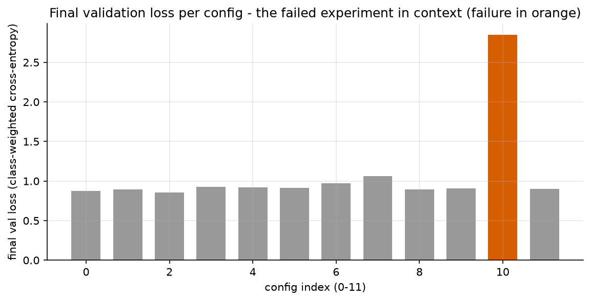

*A full loss-over-epochs curve isn't shown here, since per-epoch history was only saved for the
best config, not every config in the search — plotting each config's logged final loss instead
makes the same point honestly: config 10's final loss (2.85) is a dramatic outlier against the
other 11 configs' tight 0.854–1.064 range, not just the lowest recall bar in the earlier chart.*

### Unsuccessful experiment 4: GenAI prompt v2

In the prompt comparison described in GenAI Evaluation (Q6), above, v2 underperforms v1 on both
accuracy and PR-AUC, confirmed at n=249 after the original n=12 comparison. **v3 and v4 are
reported honestly even though they contradict what was expected going in**: both were
pre-registered as likely to underperform (v3 for dropping domain guidance, v4 for being too
conservative and suppressing recall) and both instead clearly beat v1 — v4 most of all, with
the best PR-AUC and recall@P_MIN of any prompt tried. This is not hidden or reframed as a
success after the fact; it's reported as what it is: **the original 12-image prompt comparison
was too small to reliably pick the best prompt** — a genuine methodological lesson, separate
from the four required failures listed in this section.

The official GenAI test-set result (Full Model Comparison, above) still uses v1, exactly as
locked in before test was touched — per the test-isolation rule, this finding does not trigger
a re-run on test with v4, however tempting that would be. It's recorded here as an honest
limitation of the original methodology, not acted on retroactively.

---

# Error Predictions and Analysis (Q3, Q5) {.pagebreak}

*Source: `notebooks/05_error_analysis.ipynb`, `notebooks/04_xai.ipynb`,
`experiments/log.csv`.*

## Error analysis by class, source institution, and image quality

**By class** (Final ANN, test confusion matrix, rows=true, cols=predicted,
`experiments/log.csv` id `final_ann_final_000`):

```
                Clear  Crystals  Other  Precipitate
true Clear        602       52     17       30
true Crystals        5      219      8       22
true Other            4        9     91        9
true Precipitate     50       93     94      748
```

Precipitate is the largest source of confusion for every other class (e.g. 94 true-Other images
called Precipitate), consistent with Q1's observation that Precipitate and Crystals/Other can
look visually similar at the texture level.

**By source institution** (test set, Final ANN accuracy per source):

| Source | n (test) | Accuracy |
|---|---|---|
| 0 | 51 | 68.6% |
| 1 | 343 | 74.6% |
| 2 | 334 | 84.7% |
| 3 | 1,305 | 82.3% |
| 4 | 20 | 60.0% |

This directly confirms Q1's Finding 2: the two smallest, most underrepresented training sources
(0 and 4) have the lowest test accuracy (60-69%) despite source 0 having a *high* Crystals share
(55% of its test images) — the model simply hasn't seen enough examples from these imaging
setups to generalise as well, regardless of class mix. This is a concrete, measured instance of
the web app's stated "unseen imagers" limitation (Q4), not a hypothetical one.

**By image quality** (file size quartile as a resolution/detail proxy, same approach as the EDA):

| Quality quartile | n (test) | Accuracy |
|---|---|---|
| Q1 (smallest files) | 514 | 84.4% |
| Q2 | 513 | 82.5% |
| Q3 | 513 | 82.7% |
| Q4 (largest files) | 513 | 73.9% |

Counter-intuitively, the *largest* image files have the *lowest* accuracy, not the highest. A
plausible explanation is that file size correlates with source institution/imaging equipment
more strongly than with "quality" in the sense of model-helpfulness — larger files may come from
institutions whose imaging style is simply harder for this model (consistent with the
by-source table above), rather than large files being intrinsically harder to classify. This is
reported as an observed, somewhat surprising finding rather than over-interpreted causally.

## Three incorrect predictions analysed with XAI

A confident Crystals→Precipitate false negative (crystals_prob=0.008 — the costly error type
for this project), a confident Precipitate→Crystals false alarm (crystals_prob=0.624), and a
Crystals→Other confusion (crystals_prob=0.263). The first of these is also the one shown live
in the video (`data/demo_errors/01_crystals_false_negative.png`). Analysed with the three XAI
methods introduced in Explainable AI (Q5), above.

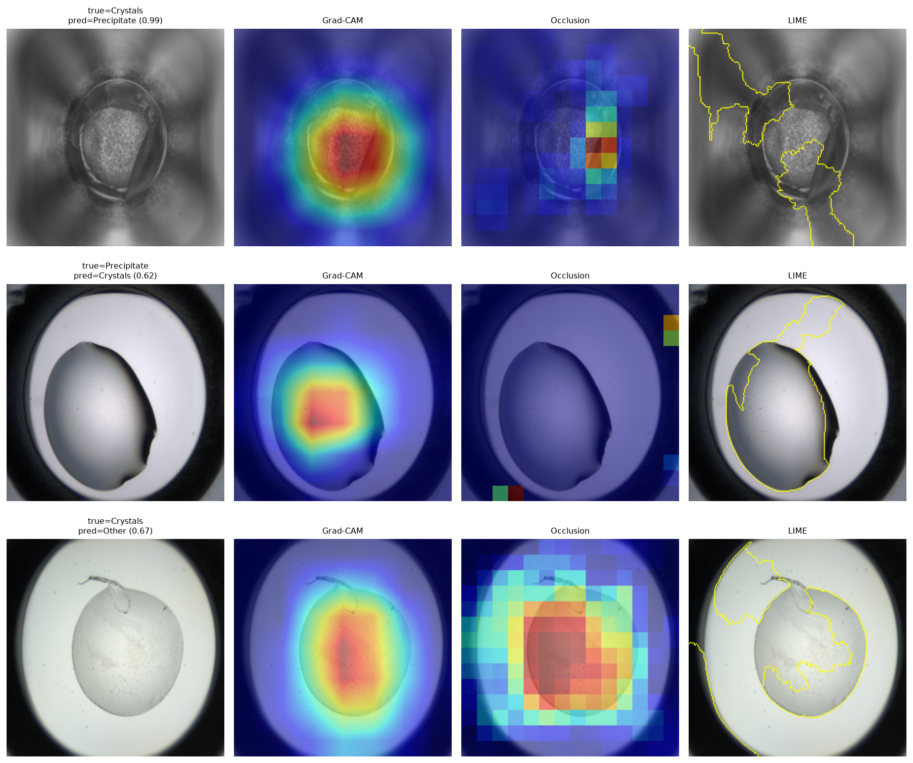

On the false negative, all three methods agree,
pointing at the drop's central region — the model is looking in a sensible place even though it
got the label wrong, suggesting the error is about feature *interpretation*, not attending to
irrelevant background. On the false alarm, occlusion genuinely **disagrees** with Grad-CAM/LIME
(its peak sensitivity is a small corner patch, not the drop centre) — reported honestly as a
real method disagreement rather than glossed over, since the three methods measure different
things (local gradient sensitivity vs. whole-block removal effect).

---

# Web Application (Q4) {.pagebreak}

*Source: `app/backend/main.py`, `app/frontend/index.html`.*

A FastAPI backend serves a simple HTML/JS frontend. The model (the Final ANN, the best by the
primary metric) is loaded once at startup, but **every prediction runs a fresh forward pass on
the uploaded image** — nothing is precomputed or hard-coded (CLAUDE.md rule 10). The user
uploads an image, receives the predicted class, a per-class score bar chart, and a Grad-CAM
heatmap overlay (Q5).

**Explaining the score:** the response includes explicit text that the score is "the model's
output probability for each class, not a calibrated or guaranteed confidence... always inspect
flagged drops visually before acting on a prediction" — never presented as a guarantee.

**Stated limitations** (shown in the app itself): unseen microscopes/lighting/plate types may
reduce accuracy (directly informed by the by-source error analysis above), and the model has no
way to say "I don't recognise this" — demonstrated during testing (below).

**Testing:**

| Input | Result |
|---|---|
| Normal (real `Clear` test image) | Correctly predicted Clear, 88.9% |
| Invalid (non-image file) | Clean HTTP 400, "Could not read this file as an image" |
| Invalid (empty file) | Clean HTTP 400 |
| Invalid (missing upload field) | Clean HTTP 422 (FastAPI's standard validation error) |
| Out-of-distribution (random noise image) | **Confidently misclassified as Crystals, 56%** |

The out-of-distribution result is a genuine, useful finding, not a failure to hide: a standard
classifier has no mechanism to recognise "this doesn't look like any training class," and this
is now documented directly in the app's own limitations text, not just in this report.

---

# Appendix A — AI-Use Declaration {.pagebreak}

*(Appendix - excluded from the 25-page main-report limit.)*

Claude Code (Anthropic) was used throughout this project as an implementation and debugging
assistant. I made the substantive decisions — architecture choices, hyperparameter framing,
metric definition, model family choices, scope trade-offs (e.g. the GenAI test-set sample
size) — and Claude wrote and tested the code, ran training/evaluation jobs, and built the
analysis notebooks to my specification. All code was written fresh for this project;
CLAUDE.md's instruction not to copy or adapt existing MARCO implementations was treated as a
hard constraint throughout.

The full, dated log of substantive AI assistance — one row per piece of work, with what was
produced and what I personally verified — is in `docs/ai_use_log.md` and reproduced below.

| Task | What was produced | What I verified |
|---|---|---|
| Download the MARCO dataset, explore the TFRecord format, design the data pipeline | `scripts/download_extract.py`, `scripts/make_splits.py`, initial `data/splits.csv`, split methodology documented in README | Ran the download/split scripts myself; checked the resulting class counts and split sizes |
| Q1 EDA notebook: class/source distributions, image quality, leakage checks | `notebooks/01_eda.ipynb`, `docs/figures/q1_*.png` | Reviewed the figures and findings; caught a real diagram error myself (pipeline showed 5 grouping tiers when there were only 4) and asked for it to be fixed |
| Investigate and fix a cross-split leakage bug I found via the notebook | Regenerated `data/splits.csv` (v2), `docs/split_v2_note.md` | Reviewed the leakage evidence and the before/after comparison; confirmed the ~44% reassignment finding made sense |
| Classical baseline: compare model families, build LightGBM on HOG+LBP features | `src/marco/features.py`, `scripts/train_baseline.py`, `experiments/log.csv` (baseline rows) | Chose LightGBM over XGBoost/SVM after reviewing a pros/cons comparison; reviewed the hyperparameter search results |
| Set the primary metric threshold (P_MIN) from the baseline's validation PR curve | `docs/primary_metric.md`, P_MIN=0.30 recorded in CLAUDE.md | Reviewed the precision/recall trade-off table before approving 0.30; asked for 0.25 to be computed as a comparison |
| Q3 classical baseline results notebook | `notebooks/02_baseline.ipynb` | Reviewed the confusion matrix, PR curve, and hyperparameter search chart; added my own model-inspection cells |
| Design and build the Initial ANN (ResNet18/34, frozen backbone + head) | `src/marco/model.py`, `src/marco/data.py`, `src/marco/metrics.py`, `scripts/train_ann.py` | Chose ResNet18 after reviewing alternatives; set the architecture decisions (direct resize not crop, augmentation choices, backbone-depth as the network-depth hyperparameter) based on my own reasoning, asked Claude to implement them |
| Set up a Colab notebook to run the ANN search on GPU | `notebooks/colab_train_ann.ipynb` | Ran it myself in Colab; debugged real GPU-quota/runtime issues together |
| Fix real bugs found while running the Initial ANN search (log-loss-on-crash risk, DataLoader hang, no progress visibility) | Incremental per-config logging, `num_workers=0`, per-epoch progress printing in `scripts/train_ann.py` | Reported the actual symptoms (hung Colab runtime, slow runs) that led to each fix; confirmed each fix resolved the issue before continuing |
| Run the real Initial ANN hyperparameter search (12 configs) on a RunPod GPU | `experiments/log.csv` (ann_initial rows), `experiments/models/ann_initial.pt` | Reviewed the per-config results as they came in; flagged when the GPU appeared stuck and asked for the pod to be replaced |
| Q3 Initial ANN results notebook + training summary doc | `notebooks/03_ann_initial.ipynb`, `docs/ann_initial_training.md` | Reviewed the learning curves, confusion matrix, and comparison table |
| Raise and record lecturer approval for the degree-of-fine-tuning hyperparameter | `docs/lecturer_approval_fine_tuning.md` | This is my own conversation with Dr. Rajadurai - I need to confirm the recorded scope matches what was actually agreed |
| Write the pre-registered expectation (Q2.b) and compute the trivial benchmark | `docs/expectation.md`, `scripts/eval_trivial_benchmark.py` | Reviewed the prediction and reasoning before it was locked in (written before any test result existed) |
| Build the test-set evaluation script and the degree-of-fine-tuning (Final ANN) training support | `scripts/final_eval.py`, `--fine-tune-degree`/`--start-idx`/`--end-idx` additions to `scripts/train_ann.py` | Asked for the parallel-GPU approach specifically; reviewed why a shared script (not a duplicate) was chosen for a fair Initial-vs-Final comparison |
| Run the real Final ANN hyperparameter search (12 configs, layer4 unfrozen) across GPU pods | `experiments/log.csv` (ann_final rows), `experiments/models/ann_final.pt` | Reviewed results as each pod finished; involved in the decision to abandon an unreliable pod and retry |
| Build the Q4 web app | `app/backend/main.py`, `app/frontend/index.html` | Need to personally try the app end-to-end before submission (not yet done as of this log entry) |
| Run the official test-set evaluation for all four models | `experiments/log.csv` (final_* rows) | Reviewed the full comparison table, including the genuine Initial-ANN-vs-baseline test/validation reversal |
| Build Grad-CAM and integrate it into the web app; build the Q5 XAI comparison (occlusion, LIME, sanity checks) | `src/marco/xai.py`, Grad-CAM in `app/backend/main.py`, `notebooks/04_xai.ipynb`, `docs/references.md` | Reviewed the three misclassified examples and the two sanity-check results |
| Build and run the Q6 GenAI evaluation (Claude Haiku 4.5, prompt selection, sample then full test set) | `experiments/prompts/*.txt`, `scripts/eval_genai.py`, `docs/genai_evaluation.md` | Decided to extend from a 250-image sample to the full test set once the real cost/time were known; reviewed the final comparison table and the (unflattering, honestly reported) result |
| Write this report, the Q2 architecture diagram, and the Q3 error-by-source/quality analysis | `docs/report.md`, `scripts/make_architecture_diagram.py`, `notebooks/05_error_analysis.ipynb` | Reviewed the error-analysis findings (underrepresented sources perform worse; largest files perform worst) before they were written up |
| Audit the "≥4 unsuccessful experiments" requirement, close the gap with feature-ablation and GenAI prompt experiments, and restructure the report into the project's actual workflow order | `scripts/eval_genai.py` (`--split` flag), `scripts/ablation_baseline_features.py`, `experiments/prompts/crystals_classification_v3.txt`/`v4.txt`, this report's restructuring | Reviewed that v3/v4 genuinely beat v1 rather than forcing a false "failure" narrative; confirmed the official test-set GenAI result was not re-run; checked every reordered section against the original for lost or duplicated content |
| Build `notebooks/06_ann_final.ipynb` (Final ANN analysis, mirroring `03_ann_initial.ipynb`'s structure) to close the asymmetry between the two ANN variants' documentation; add the Final ANN's hyperparameter-search and learning-curve figures to the report | `notebooks/06_ann_final.ipynb`, `docs/figures/q3_ann_final_*.png`, updates to `docs/report.md` | Executed the notebook for real (not hand-written outputs) and checked every printed number against what was already in the report and `experiments/log.csv` before trusting it; caught and fixed a latent filter bug (model-name `startswith` also matched the official TEST-set row) in both this notebook and `03_ann_initial.ipynb` |
| Add a full-dataset reference table to `00_download_explore.ipynb` and a chi-square goodness-of-fit test in `01_eda.ipynb` checking the 15-shard sample's class distribution against the full 407-shard population, replacing the previous eyeballed "~13%, consistent" comparison | `notebooks/00_download_explore.ipynb`, `notebooks/01_eda.ipynb`, updates to `docs/report.md` | Asked for a formal statistical test instead of an eyeballed comparison; executed both notebooks for real and read the actual chi-square statistic (2.53) and p-value (0.470) before writing the interpretation, rather than assuming the result in advance |
| Add per-shard chi-square tests (shards 1, 100, 300 vs. the full population) to `00_download_explore.ipynb` | `notebooks/00_download_explore.ipynb` | Asked for the 3-shard test specifically; the real result was mixed (shard 300 significant at p=0.016, shards 1/100 not) rather than a clean confirmation - reviewed and kept the honest, nuanced interpretation rather than only reporting the two shards that agreed |
| Add a pooled (3-shard combined) chi-square test to `00_download_explore.ipynb`, correctly summing counts before testing rather than averaging p-values | `notebooks/00_download_explore.ipynb` | Asked specifically for the pooled test; confirmed the real result (chi2=4.528, p=0.210, not significant) before writing that it resolves shard 300's individual significance as noise, rather than assuming it would |
| Add the 3-shard chi-square check (per-shard + pooled) to `docs/report.md` as the stated reason 15 shards were pulled, not just 1-2 | `docs/report.md` | Checked the numbers against the already-verified notebook output before adding them to the report; confirmed page count was unaffected |
| Fix "12 configs = 12 unique grid points" wording (actually 11 unique + 1 repeat) in `docs/report.md`/`docs/ann_initial_training.md`; add a final-validation-loss-per-config figure to `notebooks/03_ann_initial.ipynb` for the failed-experiment writeup, since no per-epoch history exists for non-best configs | `notebooks/03_ann_initial.ipynb`, `docs/figures/q3_ann_initial_failure.png`, updates to `docs/report.md`/`docs/ann_initial_training.md` | Caught the duplicate-combination nuance myself by checking experiments/log.csv directly; confirmed a per-epoch loss curve for the failed config wasn't possible (data doesn't exist) before choosing the honest alternative instead of fabricating one |

**Note:** several "what I verified" entries above still need your personal confirmation or
correction before submission (flagged individually in `docs/ai_use_log.md`) — in particular
the web app end-to-end test and the lecturer-approval scope.
